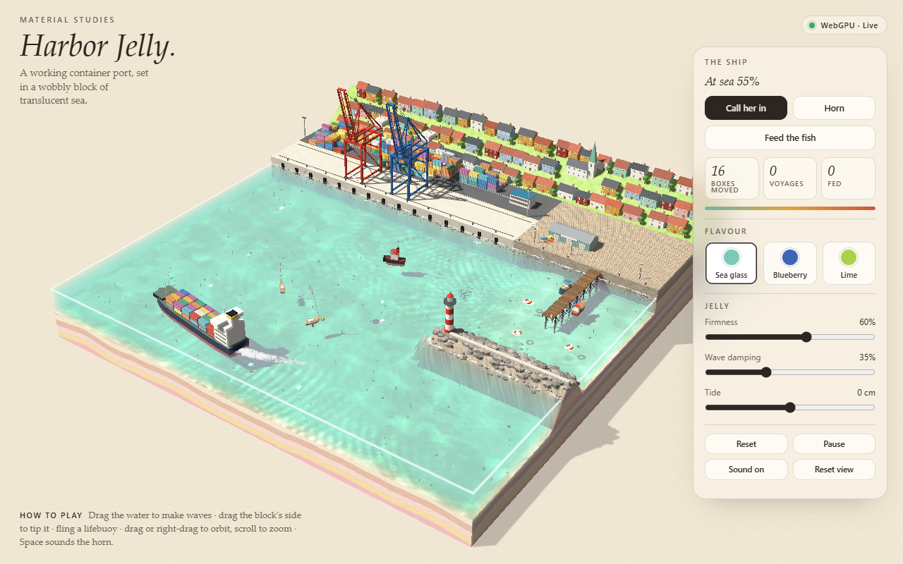

# Harbor Jelly.

*Material Studies*: a small working container harbor set inside a wobbly block of translucent jelly sea, rendered live with WebGPU and WGSL.



The whole thing is one self-contained file, [`index.html`](index.html). It makes no network requests and uses no libraries. Open it in a browser with WebGPU (recent Chrome, Edge or Safari). If WebGPU is missing, a fallback screen explains why.

The full build prompt is in [PROMPT.md](PROMPT.md).

## What's in it

- **Water:** a linear shallow-water simulation on a staggered 128 × 128 grid, with a little surface tension. It renders with refraction, depth absorption, caustics, light shafts, Fresnel reflection, foam and a meniscus on the cut edges.
- **The ship's day:** an automatic loop of about 110 s. Two gantry cranes swap boxes, a tug pulls the feeder ship off the quay, and the ship sails a lap past the lighthouse, leaving a real wake. The tug then pushes her back onto the fenders.
- **Life:** fish boids, moon jellyfish and herring gulls that land on perches.
- **Interaction:** drag the water to make waves, drag the block's side to tip it, and throw lifebuoys. Drag empty space to orbit and scroll to zoom. Space sounds the horn.

## Tests

```bash
npm install
node test/choreo.test.mjs   # headless: phase order, collisions, crane spacing, box bookkeeping, sim cost
npx playwright test         # end-to-end in installed Chrome (set PW_CHANNEL to change)
```

The choreography test runs the simulation core straight out of `index.html` (`<script id="core">`), so it checks exactly what ships.
